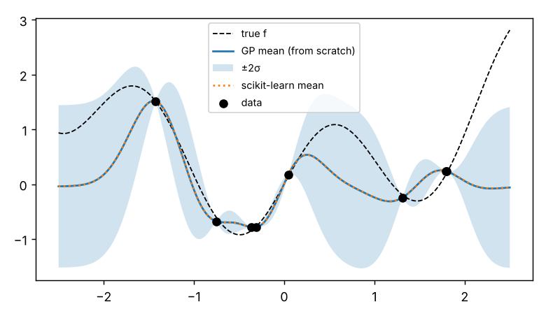
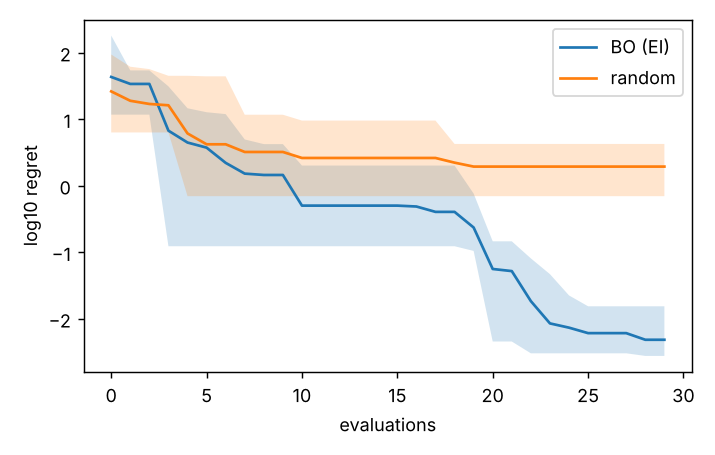
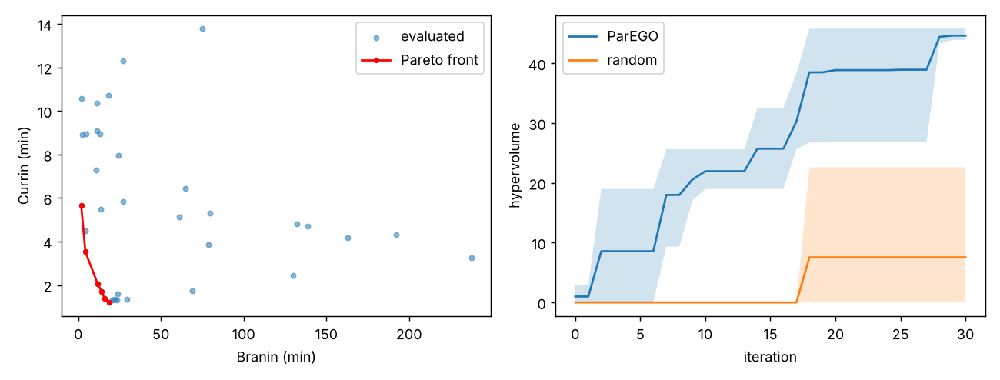
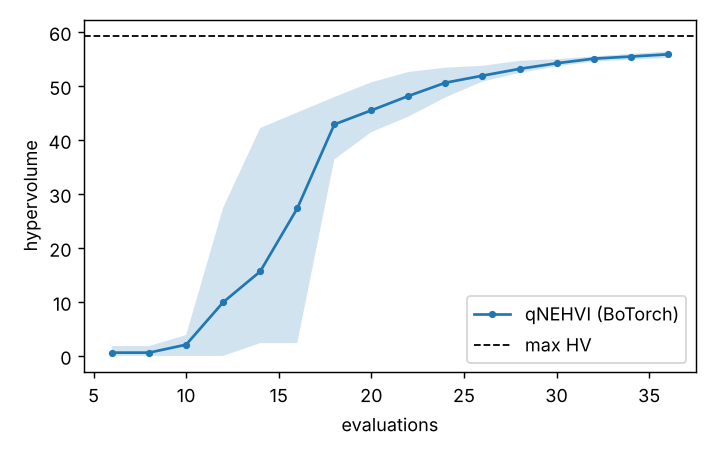

# multiobjective-bo-practice

Bayesian optimisation 학습 기록 — GP를 NumPy로 직접 구현하는 것부터 시작해
단일목적 BO, ParEGO 다목적 BO, BoTorch의 qNEHVI까지 단계별로 연습한 코드입니다.
실험 데이터 대신 **공개 벤치마크 함수**(Branin, Currin, ZDT1)만 사용합니다.

*Learning log: Gaussian processes from scratch → single-objective BO → ParEGO →
BoTorch qNEHVI, all on public benchmark functions.*

| Step | Script | 배운 것 / What I practised | Result |
|---|---|---|---|
| 1 | `01_gp_from_scratch.py` | ARD-SE 커널, Cholesky 기반 사후분포, 주변우도 최적화로 하이퍼파라미터 추정 | scikit-learn과 평균 차이 < 0.01 |
| 2 | `02_single_objective_bo.py` | Expected Improvement, 랜덤 탐색과 비교 (5 seeds) | 30회 평가 후 regret ≈ 0.006 (random 2.4) |
| 3 | `03_multiobjective_parego.py` | Chebyshev 스칼라화(ParEGO), 파레토 판별, 2-D hypervolume 직접 구현 | HV 44.6 vs random 7.5 |
| 4 | `04_botorch_qnehvi.py` | BoTorch `ModelListGP` + qLogNEHVI 배치(q=2) 획득, `optimize_acqf` | HV ≈ 56 / 59.4 (max) in 36 evals |






## 정리한 점 / Notes to self

- 관측 수가 적을 때는 **입력 정규화 + 출력 표준화**가 GP 적합 안정성에 가장 큰 영향을 줬다.
- 직접 구현한 2-D hypervolume을 BoTorch `Hypervolume`과 교차 검증해 동일한 값(18.2256)을 확인했다.
- ParEGO는 반복마다 하나의 가중치만 보므로 프런트가 계단식으로 채워지고,
  qNEHVI는 프런트 전체의 개선량을 직접 최적화해 같은 예산에서 더 빨리 수렴한다.
- 실험실 적용 시 고려할 것: 배치 크기(q)를 장비 병렬 수에 맞추기, 실패 실험(제약 위반)을
  모델에 알리는 방법, 측정 노이즈 추정.

## Next

- [ ] 제약조건이 있는 BO (feasibility GP)
- [ ] 범주형 변수 (지지체 종류 등) 혼합 공간
- [ ] multi-fidelity (빠른 저정밀 측정 + 느린 고정밀 측정)

## Run

```bash
pip install -r requirements.txt
export PYTHONPATH=.
python 01_gp_from_scratch.py      # ~1 s
python 02_single_objective_bo.py  # ~10 s
python 03_multiobjective_parego.py
python 04_botorch_qnehvi.py       # needs torch + botorch, ~5 min on CPU
python -m pytest -q
```
